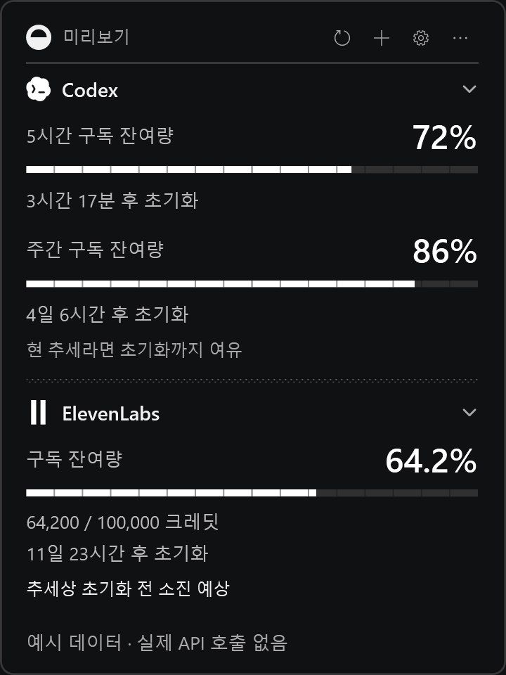
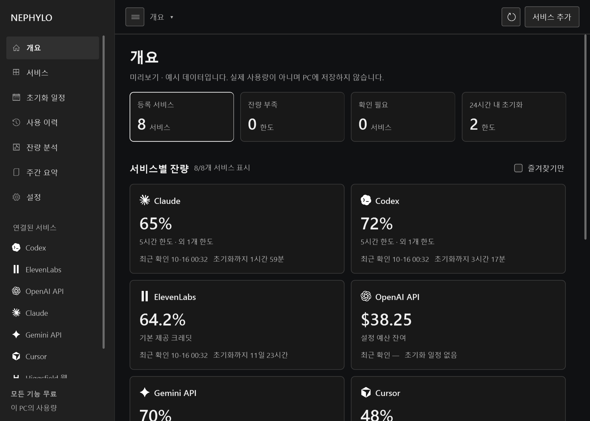
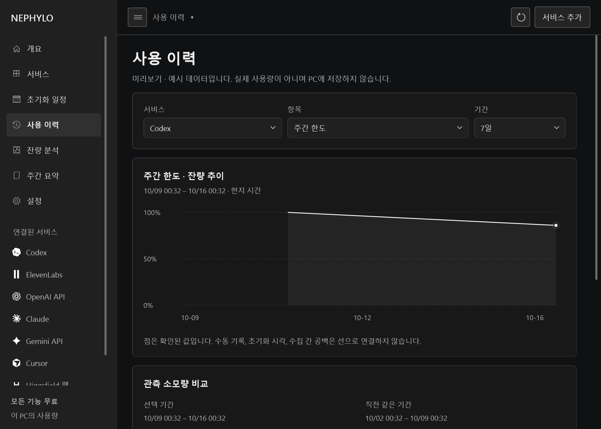

# Nephylo

**AI 서비스의 남은 사용량을, 한곳에서 가볍게.**

여러 AI 서비스의 잔여량과 초기화 시각을 Windows 바탕화면에서 확인하는 무료 오픈소스 위젯입니다. Nephylo 가입이나 결제 없이 모든 기능을 사용할 수 있습니다.

**[Windows 설치 파일 다운로드](https://nephylo.com/downloads/Nephylo-Setup.exe)** · [홈페이지](https://nephylo.com/) · [English](#english) · [MIT License](LICENSE)

<p align="center">
  
</p>

<p align="center"><sub>1.25.21의 실제 WPF UI를 예시 데이터로 렌더링한 화면입니다. 실계정 정보나 실제 사용량을 포함하지 않습니다.</sub></p>

## 설치하고 시작하기

1. [Nephylo-Setup.exe](https://nephylo.com/downloads/Nephylo-Setup.exe)를 다운로드해 실행합니다. 압축 해제나 개발 도구 설치는 필요하지 않습니다.
2. 위젯의 **＋ → 서비스 연결 · 관리**에서 사용할 AI 서비스를 연결합니다.
3. 잔여량을 확인하세요. **… → 대시보드 열기**에서 전체 현황을, **… → 간략 보기**에서 미니바를 사용할 수 있습니다.

지원 환경: **Windows 10 1903 이상(x64) 또는 Windows 11**, .NET Framework 4.8. 각 AI 서비스의 로그인·API 키·구독 및 이용 요금은 별도이며, 연결한 서비스만 위젯에 표시합니다.

<details>
<summary><strong>PowerShell로 설치하기</strong></summary>

1. [홈페이지의 PowerShell 설치 안내](https://nephylo.com/#powershell-install)를 펼칩니다.
2. 확인된 설치 명령을 복사하고, 실행할 내용을 확인합니다.
3. 일반 PowerShell 창에 붙여넣고 실행합니다.

홈페이지는 설치 스크립트의 SHA-256을 확인한 뒤 명령을 제공합니다. 스크립트는 서명된 업데이트 정보와 다운로드한 EXE를 검증합니다. 원문은 [install-nephylo.ps1](https://nephylo.com/downloads/install-nephylo.ps1)에서 읽을 수 있습니다.

</details>

연결이 잘되지 않으면 [서비스별 연결·해결 안내](https://nephylo.com/#connect)를 확인하세요. API 키나 로그인 토큰을 이슈에 첨부하지 마세요.

## 주요 기능

| 기능 | 할 수 있는 일 |
| --- | --- |
| 잔여량과 초기화 시각 | 서비스별 한도·크레딧·예산을 확인하고 초기화까지 남은 시간을 파악합니다. |
| 위젯과 미니바 | 바탕화면 위젯을 작은 가로 막대로 전환합니다. 미니바 너비는 표시하는 서비스 수에 맞춰 조절됩니다. |
| 통합 대시보드 | 여러 서비스의 현황, 초기화 일정, 사용 이력과 잔량 분석을 한 창에서 봅니다. |
| 잔량·초기화 알림 | 잔여량 부족과 초기화 일정을 알림으로 확인합니다. |
| 이력과 CSV | PC에 최대 30일의 관측 이력을 보관하고 CSV로 내보냅니다. |
| 사용 추세 분석 | 관측된 이력으로 하루 평균 소모량·소진 예상·주간 요약을 확인합니다. |
| 취향에 맞는 설정 | 다크·라이트 테마, 한국어·영어, 애니메이션, 항상 위에 표시와 Windows 시작 시 실행을 설정합니다. |
| 자동 업데이트 | 설치된 위젯이 새 버전을 감지하고 검증한 뒤 다운로드·설치·재시작합니다. |

분석 결과는 수집된 이력에 따른 추정치입니다. 수동 기록이나 관측 공백이 있는 서비스는 확인 시각과 조회 방식을 함께 확인하세요.

## 화면 살펴보기

### 작업을 가리지 않는 미니바

서비스 아이콘·잔여량·초기화 시각을 간결하게 표시합니다. 서비스를 누르면 상세 정보를 확인할 수 있습니다.


### 여러 서비스를 모아 보는 대시보드

위젯의 **… → 대시보드 열기**에서 시작합니다. 서비스별 잔량과 초기화 일정, 확인이 필요한 항목을 한곳에서 확인합니다.



<details>
<summary><strong>사용 이력 그래프도 보기</strong></summary>

서비스·항목·기간을 선택해 잔량 추이를 살펴봅니다. 점은 실제로 관측한 값을 나타내며 수동 기록이나 수집 공백을 연속 사용량으로 취급하지 않습니다.



</details>

위 화면은 모두 예시 데이터입니다. 서비스 종류와 연결 상태에 따라 표시 항목이 달라집니다.

## 서비스별 조회 방식

모든 서비스가 같은 방법으로 잔여량을 제공하지는 않습니다.

| 서비스 | 표시하는 정보·연결 방식 |
| --- | --- |
| Codex | 로그인된 Codex 앱·CLI에서 계정 한도와 초기화 시각을 조회합니다. Windows와 WSL 환경을 지원합니다. |
| ElevenLabs | 사용자 읽기 권한이 있는 API 키로 구독 크레딧 잔여량을 조회합니다. |
| Claude Code | 연결 설정 후 Claude Code 응답에서 제공하는 한도 정보를 수신합니다. Free·API 키 계정의 구독 잔여량 조회는 지원하지 않습니다. |
| OpenAI API | 조회한 사용 비용과 사용자가 설정한 예산을 비교합니다. 실제 선불 잔액을 뜻하지 않습니다. |
| Higgsfield 웹 | 공식 CLI 로그인과 작업 공간 연결 후 웹 구독 크레딧을 조회합니다. |
| Higgsfield API | API 콘솔에서 확인한 USD 잔액을 수동 기록합니다. 웹 구독 크레딧과 별도입니다. |
| Gemini API·Cursor | 사용자가 확인한 잔량을 수동 기록하고 기록 시각을 함께 표시합니다. |

Nephylo는 각 AI 서비스의 공식 제품이 아닙니다. 제공자가 공개하는 정보, 계정 요금제와 인증 상태에 따라 조회 범위가 달라질 수 있습니다.

## 개발·기여

현재 소스 버전: **1.25.21** · C# / WPF / .NET Framework 4.8

<details>
<summary><strong>소스에서 빌드하고 테스트하기</strong></summary>

Windows PowerShell 5.1과 .NET Framework 4.8을 사용합니다. 테스트 경로 길이 제한을 피하려면 `C:\src\nephylo`처럼 짧은 경로에 clone하세요.

```powershell
git clone https://github.com/jangmalza/nephylo.git C:\src\nephylo
cd C:\src\nephylo
powershell.exe -NoProfile -ExecutionPolicy Bypass -File .\work\build.ps1
if ($LASTEXITCODE -ne 0) { throw '빌드 실패' }
.\work\build\UsageWidget.exe --demo
```

`--demo`는 실제 서비스에 연결하지 않고 예시 데이터로 실행합니다. 일반 실행은 해당 Windows 사용자의 로컬 프로필을 사용합니다. 소스에서 만든 개발 빌드는 자동 설치 대상이 아닙니다.

```powershell
powershell.exe -NoProfile -STA -ExecutionPolicy Bypass -File .\work\tests\run-ci-tests.ps1
```

공개 CI는 Windows 개발 빌드·48개 오프라인 스위트, 서버 격리 테스트, 비밀정보 검사, 소스 구성·JavaScript 문법을 검사합니다. 운영 서버 배포나 실제 사용자 인증은 하지 않습니다.

</details>

[기여 안내](CONTRIBUTING.md) · [포크·독립 배포 안내](docs/OPEN-SOURCE.md) · [릴리스 절차](docs/RELEASING.md) · [이슈 등록](https://github.com/jangmalza/nephylo/issues)

공개 소스는 검증된 스냅샷에서 자동 동기화됩니다. 운영 배포 자료·개인 설정·비공개 Git 이력·기존 EXE·ZIP은 포함하지 않습니다. 웹 관리자 설정은 비활성 예제이며 공식 업데이트 검증용 공개키만 포함합니다. 웹사이트를 포크해 서비스하려면 자신의 릴리스 산출물과 운영 설정이 필요합니다.

## 라이선스

Nephylo 코드·문서·자체 아이콘은 [MIT License](LICENSE)입니다. 수정·재배포·상업적 이용 시 저작권과 라이선스 고지를 유지하세요. 외부 구성요소는 [THIRD-PARTY-NOTICES.txt](THIRD-PARTY-NOTICES.txt)와 [라이선스 목록](docs/LICENSES.md)의 조건을 따릅니다. 코드 공개가 서비스 상표나 외부 API 사용 권한을 대신하지는 않습니다.

## English

**Nephylo is a free, open-source Windows widget for AI service quotas, remaining credits and reset times.** No Nephylo account or payment is required. Provider authentication, subscriptions and API fees are separate.

**Install:** [Download Nephylo-Setup.exe](https://nephylo.com/downloads/Nephylo-Setup.exe), run it, then use **＋ → Connect services**. No build tools are required. The [website](https://nephylo.com/) also provides a verified PowerShell installation command. Requires Windows 10 1903+ x64 or Windows 11 and .NET Framework 4.8.

**Features:** desktop widget, compact minibar, unified dashboard, quota/reset alerts, up to 30 days of local history, CSV export, usage forecasts, weekly summaries, dark/light themes, Korean/English and automatic updates for installed copies.

**Provider scope:** Codex and ElevenLabs expose quota/credit readings; Claude Code reports supported limits after a response; OpenAI API shows costs against your configured budget, not prepaid balance. Higgsfield web credits use its CLI connection. Higgsfield API balance, Gemini API and Cursor use manual records. Claude Free/API-key subscription quotas are not supported.

The images above show the actual 1.25.21 WPF views rendered with built-in demo data, without live accounts. See [CONTRIBUTING.md](CONTRIBUTING.md) for contributions and [docs/OPEN-SOURCE.md](docs/OPEN-SOURCE.md) before distributing a fork. Licensed under [MIT](LICENSE); third-party notices remain applicable.
